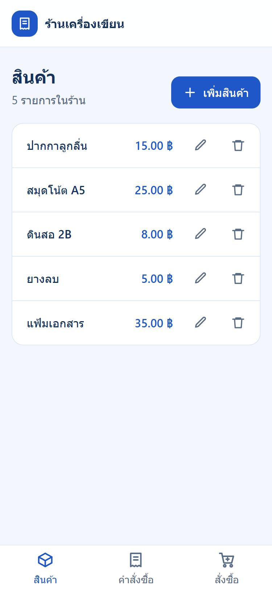
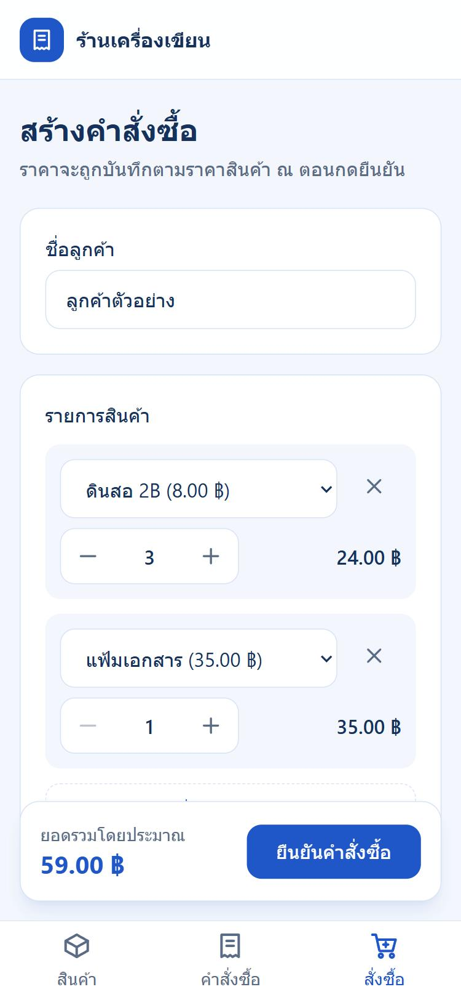
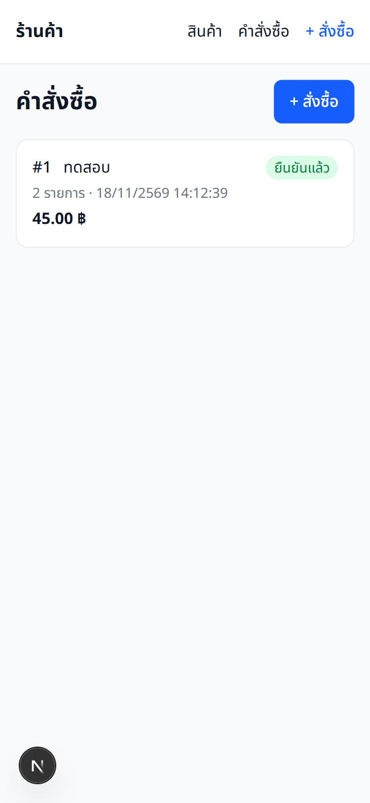
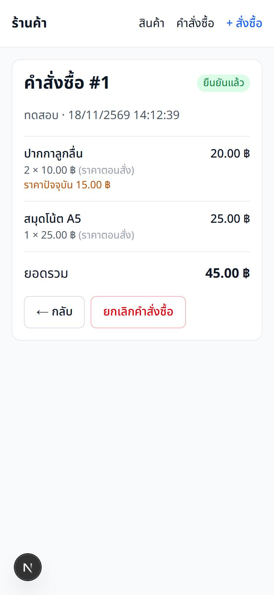

# ระบบขายสินค้าและคำสั่งซื้อ

ระบบจัดการสินค้าและคำสั่งซื้อที่มีหลายรายการ โดย**ราคาที่บันทึกในคำสั่งซื้อเดิมจะคงเดิม แม้ราคาในทะเบียนสินค้าจะเปลี่ยน**

| | ลิงก์ |
|---|---|
| 🌐 เว็บ (Vercel) | https://test-to-siam.vercel.app |
| 🔌 API (Render) | https://test-to-siam.onrender.com/api/health |
| 🗄️ Database script | [`database/schema.sql`](database/schema.sql) |
| 💻 Source code | [`frontend/`](frontend) (Next.js) · [`backend/`](backend) (Laravel) |

> ⚠️ API อยู่บน Render แพ็กเกจฟรี เครื่องจะหลับเมื่อไม่มีคนใช้งาน **การเปิดครั้งแรกอาจต้องรอประมาณ 1 นาที** (หน้าเว็บจะแสดง "กำลังโหลด…" ระหว่างรอ)

## ภาพหน้าจอ (มือถือ)

| สินค้า | สร้างคำสั่งซื้อ | รายการคำสั่งซื้อ | รายละเอียดคำสั่งซื้อ |
|---|---|---|---|
|  |  |  |  |

ภาพสุดท้ายคือเงื่อนไขหลักของโจทย์: ปากกาถูกสั่งไปตอนราคา 10 บาท แล้วถูกแก้ราคาเป็น 15 บาททีหลัง คำสั่งซื้อเดิมยังคิดที่ 10 บาท (ยอดรวม 45 บาทไม่เปลี่ยน) และแสดงราคาปัจจุบันไว้ให้เทียบ

## ลองเงื่อนไขหลักด้วยตัวเอง

1. ไปที่ **+ สั่งซื้อ** เลือกสินค้าหลายรายการ แล้วกดยืนยัน
2. ไปที่ **สินค้า** → **แก้ไข** แล้วเปลี่ยนราคาสินค้าที่เพิ่งสั่ง
3. กลับไปเปิดคำสั่งซื้อเดิม → ราคาและยอดรวมยังเท่าเดิม และมีบรรทัด "ราคาปัจจุบัน" แสดงอยู่

## เทคโนโลยี

| ส่วน | ใช้อะไร | Deploy ที่ |
|---|---|---|
| Frontend | Next.js 15 + Tailwind CSS (responsive) | Vercel |
| Backend | Laravel 12 (PHP 8.2) แบบ API อย่างเดียว | Render (Docker) |
| Database | PostgreSQL | Supabase |
| Tests | PHPUnit + SQLite in-memory | — |

```
frontend/   Next.js: หน้าเว็บ 5 หน้า เรียก API ผ่าน src/lib/api.ts
backend/    Laravel: REST API, migrations, tests, Dockerfile
database/   schema.sql: script สร้างตาราง (PostgreSQL)
docs/       ภาพหน้าจอ
```

## การออกแบบ

### ตาราง

SQL สำหรับสร้างตาราง + ข้อมูลตัวอย่าง: [`database/schema.sql`](database/schema.sql) (ตอน deploy จริงตารางถูกสร้างด้วย Laravel migrations ใน [`backend/database/migrations/`](backend/database/migrations))

| ตาราง | คอลัมน์ |
|---|---|
| `products` | id, name, price `DECIMAL(10,2)`, deleted_at, timestamps |
| `orders` | id, customer_name, status (`confirmed` / `cancelled`), timestamps |
| `order_items` | id, order_id, product_id, **product_name**, **unit_price** `DECIMAL(10,2)`, quantity, timestamps |

### ทำไมราคาเดิมถึงไม่เปลี่ยน

- ตอนสร้างคำสั่งซื้อ backend **คัดลอก `product_name` และ `unit_price` ลงใน `order_items`** (snapshot) ยอดรวมและราคาที่แสดงในคำสั่งซื้อคำนวณจากค่าเหล่านี้เท่านั้น ไม่มีการ JOIN ไปเอาราคาจาก `products`
- frontend ส่งมาแค่ `product_id` และ `quantity` ส่วน **ราคา backend อ่านจากฐานข้อมูลเอง** ถ้า client ส่งราคามาด้วยก็จะถูกละทิ้ง (กันการยิง API ซื้อของในราคาที่ตั้งเอง)
- สร้างคำสั่งซื้อและทุกรายการภายใน **transaction เดียว** ถ้ารายการไหนผิด จะยกเลิกทั้งใบ
- สินค้าถูก **soft delete** (`deleted_at`) คำสั่งซื้อเก่าที่อ้างถึงจึงยังอยู่ครบ แต่สั่งสินค้าที่ลบแล้วไม่ได้
- เงินเก็บเป็น `DECIMAL` ไม่ใช้ `FLOAT` และคำนวณยอดรวมเป็นหน่วยสตางค์ (จำนวนเต็ม) กันทศนิยมเพี้ยน
- ไม่เก็บยอดรวมไว้ในตาราง เพราะรายการในคำสั่งซื้อแก้ไขไม่ได้ ยอดที่คำนวณจาก snapshot จึงไม่มีวันเปลี่ยน

### API

| Method | Path | หมายเหตุ |
|---|---|---|
| GET / POST | `/api/products` | |
| GET / PUT / DELETE | `/api/products/{id}` | DELETE = soft delete |
| GET / POST | `/api/orders` | POST: `{ customer_name, items: [{ product_id, quantity }] }` |
| GET | `/api/orders/{id}` | มี `unit_price` (ราคาตอนสั่ง) และ `current_price` (ราคาปัจจุบัน ใช้แสดงผลเท่านั้น) |
| POST | `/api/orders/{id}/cancel` | ยกเลิกซ้ำไม่ได้ (422) |
| GET | `/api/health` | |

กฎ validation: ราคา ≥ 0, จำนวนเต็ม ≥ 1, ต้องมีอย่างน้อย 1 รายการ, ห้ามสินค้าซ้ำในคำสั่งซื้อเดียว, ห้ามสั่งสินค้าที่ถูกลบ

## Tests

[`backend/tests/Feature/PriceSnapshotTest.php`](backend/tests/Feature/PriceSnapshotTest.php)

- สร้างสินค้าราคา 100 → สั่ง 2 ชิ้น → แก้ราคาเป็น 150 → คำสั่งซื้อยังเป็น 100 และยอดรวม 200
- คำสั่งซื้อหลายรายการคิดยอดถูก
- ราคาที่ client ส่งมาถูกละทิ้ง
- คำสั่งซื้อยังอยู่หลังลบสินค้า แต่สั่งสินค้าที่ลบแล้วไม่ได้
- กฎ validation และการยกเลิกได้ครั้งเดียว

```bash
cd backend
php artisan test
```

## รันบนเครื่อง

ต้องมี PHP 8.2+ (พร้อม extension `pdo_sqlite`), Composer และ Node.js 20+

**Backend** (ใช้ SQLite ในเครื่อง ไม่ต้องตั้งค่าฐานข้อมูล)

```bash
cd backend
composer install
cp .env.example .env
php artisan key:generate
php artisan migrate --seed
php artisan serve
```

**Frontend** (อีก terminal)

```bash
cd frontend
npm install
cp .env.example .env.local
npm run dev
```

เปิด http://localhost:3000

## สิ่งที่ตัดสินใจไม่ทำ

- **สต็อกสินค้า**: โจทย์ไม่ได้ระบุ
- **ระบบ login / ตารางลูกค้า**: ใช้ช่อง `customer_name` แทน เพราะโจทย์กำหนดข้อมูลหลักไว้แค่สินค้า คำสั่งซื้อ และรายการ
- **แก้ไขคำสั่งซื้อหลังสร้าง**: ทำได้แค่ยกเลิก เพื่อให้ราคาที่ snapshot ไว้มีความหมายชัดเจน
- **ตารางประวัติราคา**: snapshot ใน `order_items` เพียงพอสำหรับเงื่อนไขนี้แล้ว
- **หน้า login แอดมิน**: ไม่อยู่ในขอบเขตของโจทย์

## หมายเหตุการ deploy

- **Render**: Root Directory `backend` ใช้ Docker และตอนเครื่องเริ่มทำงานจะรัน `migrate` + `db:seed` (seeder เพิ่มเฉพาะสินค้าตัวอย่างที่ยังไม่มี จึงไม่สร้างข้อมูลซ้ำ)
  env ที่ต้องตั้ง: `APP_KEY`, `APP_ENV=production`, `APP_DEBUG=false`, `DB_CONNECTION=pgsql`, `DB_URL` (Supabase **Session pooler**), `SESSION_DRIVER=file`, `CACHE_STORE=file`, `CORS_ALLOWED_ORIGINS`
- **Vercel**: Root Directory `frontend` และตั้ง env `NEXT_PUBLIC_API_URL=https://test-to-siam.onrender.com/api`
- **Supabase**: ต้องใช้ connection string แบบ Session pooler เพราะ Direct connection เป็น IPv6 ซึ่ง Render ต่อไม่ได้
